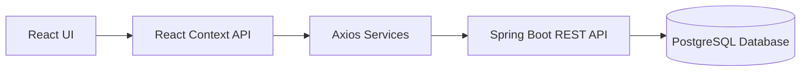
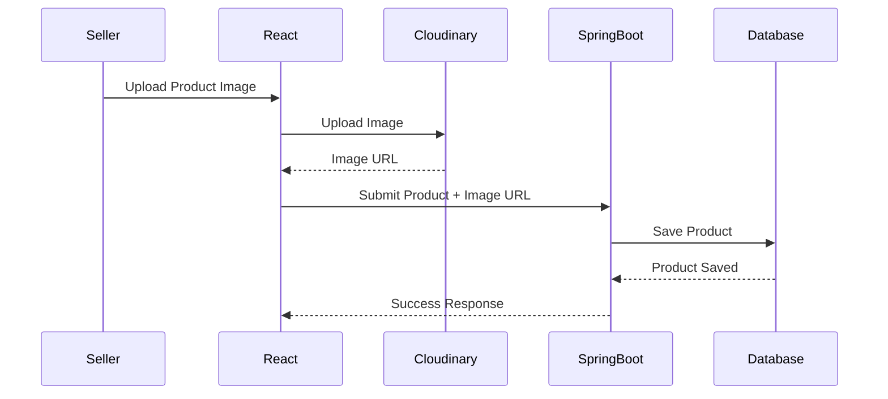

# 🛒 Alaba Commerce UI

A modern **React + TypeScript** frontend for the **Alaba Commerce** e-commerce platform, built with **Vite**, **Tailwind CSS**, and **React Context API**. It integrates seamlessly with a **Spring Boot REST API** to provide a secure and scalable online marketplace for buyers and sellers.

---

## Overview

Alaba Commerce is a full-stack e-commerce platform that enables:

- Buyers to discover, search, filter, and purchase products.
- Sellers to manage their inventory through a dedicated dashboard.
- Secure authentication and authorization using JWT.
- Image hosting via Cloudinary.

The frontend communicates with a Spring Boot backend through RESTful APIs.

---

# ✨ Features

## Authentication

- JWT Authentication
- User Registration
- Login
- Protected Routes
- Buyer & Seller Roles
- Persistent Authentication

---

## Buyer Features

- Browse Products
- Product Details
- Category Filtering
- Product Search
- Shopping Cart
- Pagination
- Product Sorting
- Responsive Design

---

## Seller Features

- Seller Dashboard
- Create Products
- Edit Products
- Delete Products
- Upload Product Images
- Inventory Management

---

#  Tech Stack

| Technology | Purpose |
|------------|---------|
| React | UI Library |
| TypeScript | Type Safety |
| Vite | Build Tool |
| React Router | Routing |
| Axios | API Communication |
| Tailwind CSS | Styling |
| React Context API | Global State Management |
| Cloudinary | Image Hosting |

---

# 🏗 System Architecture



---

# 🖼 Image Upload Flow



---

# 🖥 Main Screens

- Home Page
- Product Listing
- Product Details
- Login
- Register
- Shopping Cart
- Seller Dashboard
- Add Product
- Edit Product
- Manage Products

---

# Backend

The frontend consumes a REST API built with Spring Boot.

**Backend Repository:**

👉 https://github.com/LolaVictoria/E-Commerce-Backend

---

# 🚀 Getting Started

Clone the repository

```bash
git clone https://github.com/LolaVictoria/E-Commerce-Store.git
```

Install dependencies

```bash
npm install
```

Start the development server

```bash
npm run dev
```

---

# 🌍 Environment Variables

Create a `.env` file in the project root.

Example:

```env
VITE_API_BASE_URL=http://localhost:8080
VITE_CLOUDINARY_CLOUD_NAME=your_cloud_name
```

---